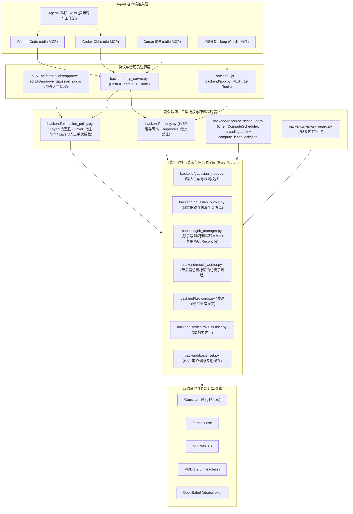

# Gaussian AI Computational Chemistry 架构设计文档 (V5.1)

## 1. 总体分层架构

本项目面向计算化学工作流自动化与 AI Agent 协同，由底层计算引擎向高层协议逐层解耦：

---

## 2. V5.1 关键架构加固

1. **核心算法零冗余**：计算化学输入输出、规则校验、任务状态与资源租约均集中于 `backend/`，DSH Backend (`app.py`) 与 MCP Server (`mcp_server.py`) 作为独立 OS 进程共享同一底层实现。
2. **跨进程内核资源锁 (`ChemComputeScheduler`)**：在原内存 `threading.Lock()` 之上叠加 OS 文件排他锁 (`compute_lease.lock`：`msvcrt.locking` / `fcntl.flock`) 与原子持久化租约 (`compute_lease.json`)，使 DSH 与多 MCP 客户端无法突破全局串行互斥与内存限制，并具备崩溃租约回收与活跃 `g16` 子进程保护能力。
3. **三层信任域分离与防越权沙箱**：
   - `Layer 1`（完整性）：`integrity_token` 绑定文件 SHA-256 与资源预算，固定 `grants_human_approval=False`。
   - `Layer 3`（带外人工授权）：签名密钥存于 `<GAUSSIAN_DATA_DIR>/approvals/.human_signing_key`，`backend/security.py` 显式禁止任何 MCP 工具访问 `approvals/` 目录；授权接口仅存于 `scripts/approve_gaussian_job.py` 与受 `_require_admin` 保护的 `POST /v1/admin/jobs/approve`，且通过单次 `nonce` 拦截重放。
   - `Layer 2`（宿主硬门禁）：必须外部配置 `GAUSSIAN_ALLOW_REAL_EXECUTION=true`。
4. **仿真产物强制隔离 (`Mock Isolation`)**：`backend/mock_worker.py` 在仿真日志嵌入 `[MOCK_GAUSSIAN_SIMULATION]` 等标识，`gaussian_output.py` 与 `job_manager.py` 自动识别并锁定 `is_simulated=True`、`real_gaussian_result=False`、`final_energy=None`/`last_energy=None`，合成值仅存于 `simulated_energy`。
5. **四类路径边界控制**：`Read Roots`、`Write Roots`、`Cache Roots` (`~/.gaussian-dsh/basis_cache/` 与 `GAUSSIAN_CACHE_DIR`)，外加 `approvals/` 显式禁止区；全面通过 `Path.resolve()` 规范化防御软链接与 Windows Junction 逃逸。

---

## 3. 全量 12 个标准 MCP 工具矩阵 (V5.1)

| 工具名称 | 所属阶段 | 核心作用与能力 | 安全机制与资源控制 |
|---|---|---|---|
| `gaussian_status` | 阶段二 | 检查 G16、formchk、工作目录、只读/只写根、原子上限与跨进程租约 | 纯只读，秒级返回 |
| `generate_gaussian_input` | 阶段二 | 构建合规 `.gjf`，校验方法/基组/电荷/多重度与 Link 0 | `<= 300` 原子；仅限 Write Roots |
| `parse_gaussian_output` | 阶段二 | 解析 `.log/.out` 提取科学指标；严格隔离仿真占位能量 | 仅限 Read Roots；100MB 阈值；仿真标记锁定 |
| `diagnose_gaussian_error` | 阶段二 | 诊断 SCF/优化/内存等错误并提供参数修复建议 | 默认本地快速路径 (<0.05s) |
| `search_gaussian_keywords` | 阶段三 | 检索分类词条（任务类型、泛函、SCF、溶剂、错误处理） | 纯内存检索；上限 `<= 50` |
| `search_basis_sets` | 阶段三 | 搜索 BSE 基组库与适用化学元素 | 专用磁盘缓存 + 离线回退 |
| `get_basis_set` | 阶段三 | 获取标准基组定义（`gaussian94` 等），支持存盘 | 受 Cache / Write Roots 沙箱检查 |
| `generate_gaussian_input_from_smiles` | 阶段三 | 2D SMILES -> 3D 构象优化 (ETKDGv3+MMFF94s) -> 完整 GJF | 内存守卫 + 跨进程 RDKit 租约 + `<= 300` 原子 |
| `submit_gaussian_calculation` | V5.0/5.1 | 预检签名、受控仿真或三层人工授权真实执行提交 | 默认 `dry_run=True`；三层授权 + 跨进程原子锁 |
| `get_gaussian_job_status` | V5.0/5.1 | 实时查询进度、步数、能量与日志尾；采纳跨进程磁盘终态 | 有界尾读 (`<= 100` 行)；仿真能量隔离 |
| `list_gaussian_jobs` | V5.0/5.1 | 分页列出计算队列及仿真状态标记 | 分页截断 (`<= 100`)；排除 `.recover.json` |
| `stop_gaussian_calculation` | V5.0/5.1 | PID 实例创建时间核对后树状拆除，支持跨进程状态同步与重复停止拦截 | 防 PID 复用误杀；释放跨进程租约 |
