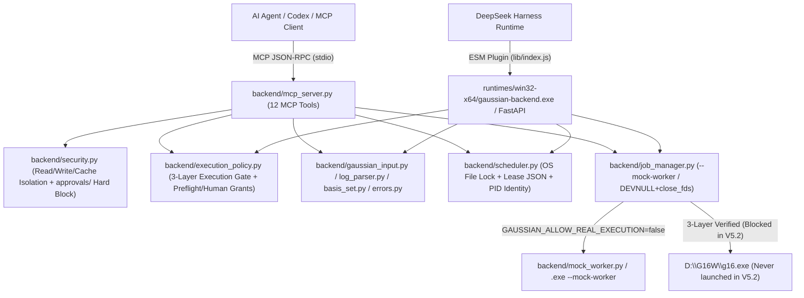

# Gaussian DSH Plugin & MCP Server 系统架构（V5.2）

> 本文档描述当前 `feature/mcp-server` 分支在 V5.2 收尾后的真实双入口架构、编译运行时一致性、跨进程锁与三层执行授权边界。

---

## 1. 分层与跨进程双入口架构

---

## 2. 已注册的 12 个 MCP 工具（与 V5.1 保持零扩张）

| 批次 | MCP 工具名 | 职责类别 | 底层共享/核心模块 |
| :--- | :--- | :--- | :--- |
| Batch 1 | `gaussian_status` | 只读状态（含跨进程 `active_compute_lease`） | `config.py`, `scheduler.py` |
| Batch 1 | `generate_gaussian_input` | 受控写目录 `.gjf` 生成 | `gaussian_input.py`, `security.py` |
| Batch 1 | `parse_gaussian_output` | 受控读 `.log` / `.out`（识别模拟标识） | `log_parser.py`, `security.py` |
| Batch 1 | `diagnose_gaussian_error` | SCF / 收敛 / 资源错误诊断 | `errors.py` |
| Batch 2 | `smiles_to_gjf` | RDKit 3D 构象嵌入与 `.gjf` 生成 | `smiles_utils.py`, `gaussian_input.py` |
| Batch 2 | `search_basis_sets` | Basis Set Exchange 元数据检索（离线回退） | `basis_set.py` |
| Batch 2 | `get_basis_set` | 获取基组（受控读写 `~/.gaussian-dsh/basis_cache/`） | `basis_set.py`, `security.py` |
| Batch 2 | `search_gaussian_keywords` | 路由关键字离线检索 | `keywords.py` |
| Batch 3 | `run_gaussian_calculation` | Pre-flight Dry-Run / Mock 模拟 / 三层授权真实计算门控 | `execution_policy.py`, `job_manager.py`, `scheduler.py` |
| Batch 3 | `get_gaussian_job_status` | 作业状态与实时进度查询 | `job_manager.py`, `process_utils.py` |
| Batch 3 | `list_gaussian_jobs` | 作业清单与调度租约核对 | `job_manager.py`, `scheduler.py` |
| Batch 3 | `stop_gaussian_calculation` | 跨进程作业终止（PID 复用校验 + `stopped` 终态锁定） | `job_manager.py`, `process_utils.py` |

---

## 3. V5.2 关键架构加固项

1. **PyInstaller 打包入口与子进程管道一致性（[entrypoint.py](file:///E:/YDW/ChemDatas/gaussian-dsh-plugin/backend/entrypoint.py)、[job_manager.py](file:///E:/YDW/ChemDatas/gaussian-dsh-plugin/backend/job_manager.py)、[process_utils.py](file:///E:/YDW/ChemDatas/gaussian-dsh-plugin/backend/process_utils.py)）**：
   - 新增 `_maybe_run_mock_worker()` 在导入 FastAPI 应用前拦截 `--mock-worker` 与 `-m backend.mock_worker`，使冻结版 `gaussian-backend.exe` 与源码模式使用一致的后台 worker 生命周期。
   - 在 Windows stdio MCP 会话下，`job_manager.py` 与 `spawn_subprocess()` 统一传入 `stdin=subprocess.DEVNULL, close_fds=True`，彻底消除子进程继承管道句柄导致的 CRT 启动挂起故障。
2. **FastAPI `POST /v1/jobs` 与 MCP 三层授权对齐（[execution_policy.py](file:///E:/YDW/ChemDatas/gaussian-dsh-plugin/backend/execution_policy.py)、[app.py](file:///E:/YDW/ChemDatas/gaussian-dsh-plugin/backend/app.py)）**：
   - 提取共享函数 `evaluate_real_content_authorization()` 与 `run_preflight_check_content()`。
   - `SubmitJobRequest` 新增 `mock_mode`、`fail_scf`、`mock_duration`、`dry_run`、`integrity_token`、`auth_token`、`human_approval_token`、`preflight_id`。非 `mock_mode`/`dry_run` 作业一律经由同一三层门控校验（文件 SHA-256 + 资源一致性 -> `GAUSSIAN_ALLOW_REAL_EXECUTION=true` -> 单次人工 `human_approval_token` + `approvals/grants/<preflight_id>.json` 回执消费），拒绝时返回 HTTP 200 `{ok: false, rejected_layer, ...}`。
   - `verify_human_approval(..., consume=True)` 确保即使调用方显式携带 `human_approval_token`，消费后仍立即删除对应的宿主回执文件以防重放。
3. **信任边界声明（MCP / HTTP 控制面 vs 同账户 OS Shell）**：
   - 当 Agent 仅能调用 MCP 工具或受控 HTTP API 时，`security.py` 对 `approvals/` 目录的硬拒绝及 `/v1/admin/jobs/approve` 的本地回环 + `Bearer <managed_token>` 校验可有效隔离 `.human_signing_key` 与审批回执。
   - 若恶意模型或脚本在同一 Windows 操作系统用户权限下被赋予任意 OS Shell 执行能力，MCP 协议沙箱本身无法阻止同账户文件读取；生产及多租户无人值守主机必须通过独立操作系统账户与 NTFS ACL 隔离操作者私钥与审批目录。
4. **跨机器默认值与打包路径兼容（[config.py](file:///E:/YDW/ChemDatas/gaussian-dsh-plugin/backend/config.py)、[index.js](file:///E:/YDW/ChemDatas/gaussian-dsh-plugin/src/index.js)、[package.json](file:///E:/YDW/ChemDatas/gaussian-dsh-plugin/package.json)）**：
   - `_default_work_dir()` 在未配置 `GAUSSIAN_WORK_DIR` 且历史目录不存在时自动回退至 `<data_dir>/gjf`（默认 `%USERPROFILE%\.gaussian-dsh\gjf`）。
   - `src/index.js` 中的 `GAUSSIAN_GUIDANCE` 改为引导 Agent 查询 `gaussian_status`，移除对特定开发机硬件与路径的硬编码。
   - 包名保留 `@gd/gp`（DSH `.generations/live` 下最深 RDKit DLL 路径约 `253` 字符 `< 260`），并在 [README.md](file:///E:/YDW/ChemDatas/gaussian-dsh-plugin/README.md) 中明示 `@yangdw2024/gp` 长路径风险（`~269` 字符需系统启用 `LongPathsEnabled`）。
