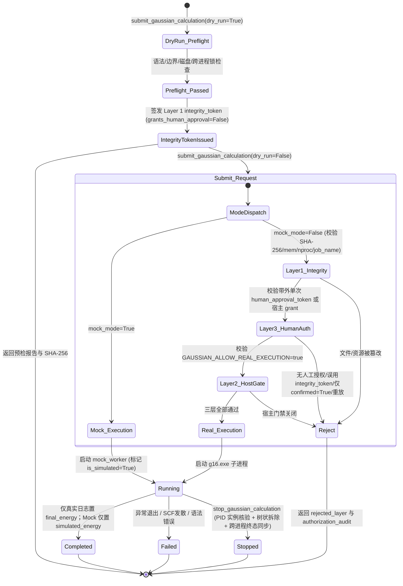

# Gaussian 计算任务调度与生命周期规范 (V5.1)

## 1. 概述与设计原则

在 AI Agent（如 Claude Code, Codex, Cursor, DeepSeek Harness）协同调用量子化学软件时，计算任务消耗高额 CPU、内存与商业软件许可。为此，Gaussian MCP V5.1 在 V5.0 基础上建立了**跨进程统一调度锁**、**三层独立执行授权隔离**与**受控仿真成果隔离**机制：

- DSH FastAPI 后端 (`backend/app.py`) 与 MCP Server (`mcp_server.py`) 作为独立 OS 进程运行，通过内核文件锁共享同一套计算资源租约与任务持久化状态。
- Agent 自动签发的预检令牌仅验证**文件与参数完整性**，绝不等同于**人类对具体任务的执行批准**。
- 任何仿真 (`mock_mode=True`) 结果均带显式仿真标识并隔离能量字段，绝不冒充真实 Gaussian 硬件计算结果。

---

## 2. 三层独立执行授权模型 (3-Layer Execution Policy)

### Layer 1: 文件与参数完整性校验 (`integrity_token`)
- 由 `dry_run=True` 预检通过后自动签发，使用独立完整性密钥域 (`GAUSSIAN_INTEGRITY_DOMAIN::...`) 进行 HMAC-SHA256 签名。
- 载荷绑定 `kind="file_integrity"`、`grants_human_approval=False`、`preflight_id`、`sha256`、`job_name`、`mem`、`nproc` 及有效期 (`exp`)。
- 若预检后 `.gjf` 文件被修改，或提交时擅自调高 `%mem` / `%nproc` 配额，Layer 1 立即拒绝执行。

### Layer 3: 带外人工任务授权 (`human_approval_token` / 宿主签发凭据)
- 签名密钥持久化至 `<GAUSSIAN_DATA_DIR>/approvals/.human_signing_key`，该目录被 `backend/security.py` 明确拉黑，**所有 MCP 工具均无法读写该目录与签发凭据**。
- 仅可由人类面向接口签发（永不注册为 MCP 工具）：
  1. 独立操作员 CLI：`scripts/approve_gaussian_job.py`
  2. 受 `_require_admin` 保护的 DSH 宿主端点：`POST /v1/admin/jobs/approve`
- 防绕过与防重放硬规则：
  - 传入 `confirmed=True` 配合 `integrity_token` 时直接被拒绝 (`rejected_layer="human_authorization"`)。
  - 将 `integrity_token` 填入 `human_approval_token` 时触发显式检测拦截。
  - 含一次性密码学 `nonce`：首次合法消费后写入 `approvals/consumed/<nonce>.used` 并删除对应 `grants/<preflight_id>.json`，二次提交立即拦截防重放。

### Layer 2: 宿主级物理执行门禁 (`GAUSSIAN_ALLOW_REAL_EXECUTION`)
- 仅在宿主环境显式配置 `GAUSSIAN_ALLOW_REAL_EXECUTION=true`（或 `1` / `yes`）时才允许调用物理二进制 `g16.exe`。
- 即使 Layer 1 与 Layer 3 均已满足，在未开启物理授权的工作站/CI 环境中仍会在 `rejected_layer="host_execution_gate"` 处精确阻断。

---

## 3. 跨进程调度互斥与生命周期管理 (`ChemComputeScheduler` + `JobManager`)

### 3.1 跨进程原子计算租约
- 重型任务（`gaussian`、`multiwfn`、`vmd`、`rdkit`）共享单一跨进程独占租约：
  - **进程内**：`threading.Lock()`
  - **跨 OS 进程**：基于 `compute_lease.lock` 的内核排他锁（Windows `msvcrt.locking` / POSIX `fcntl.flock`）与 `os.replace()` 原子替换的 `<GAUSSIAN_DATA_DIR>/compute_lease.json`
  - **元数据记录**：保存 `owner_id`、`kind`、`acquired_at`、`holder_pid`、`holder_pid_start_time`、`host_client` (`dsh_backend` vs `mcp_server`)
- **崩溃回收与孤儿保护**：
  - 若非 Gaussian 租约持有进程意外崩溃，下一请求读取租约时校验到 `holder_pid` 已死亡（或 PID 已复用），自动安全清理失效租约。
  - 若 DSH `admin_shutdown` 有意保留运行中的 `g16` 子进程，`jobs/<owner_id>.json` 中子进程依然存活且实例匹配时，系统**继续保留该 `gaussian` 租约**，防止新客户端误抢占。

### 3.2 提交与终态跨进程一致性
- `JobManager.submit()` 原子写入 `.tmp -> os.replace()` 保存主任务 JSON 与 `.recover.json`，并在成功取得跨进程 lease 后再次调用 `has_running()` 复查孤儿任务，彻底消灭双客户端并发竞态 (TOCTOU)。
- `_finalize_if_dead()`、`get_job()` 与 `stop_job()` 优先读取磁盘持久化主记录：若另一进程已将其置为终态 (`stopped`/`completed`/`failed`)，本地进程立即采纳磁盘终态而不允许用本地陈旧内存副本覆写。

### 3.3 PID 实例复用保护与进程树终止
- 任务启动时记录目标进程的精准创建时间 (`pid_start_time`)；在状态检查与 `stop_gaussian_calculation` 终止前调用 `pid_is_same_instance()` 复核，若判定 PID 已被无关 OS 进程复用 (`False`)，立即拒绝终止并发出人工核查警告。
- Windows 下采用 `taskkill /F /T /PID <pid>` 拆除完整进程树，并轮询确认进程彻底退出后再写入 `stopped` 与释放 lease；禁止对 `stopped` / `completed` / `failed` 任务重复终止。

---

## 4. 受控仿真与科研数据隔离

- 启用 `mock_mode=True` 时，`backend/mock_worker.py` 在 `.log` 输出中嵌入 `[MOCK_GAUSSIAN_SIMULATION]` 等不可忽略标志。
- `parse_gaussian_output`、`get_gaussian_job_status` 与 `list_gaussian_jobs` 对所有仿真任务强制执行：
  - `is_simulated = True`
  - `real_gaussian_result = False`
  - `execution_mode = "mock_simulation"`
  - `final_energy = None` / `last_energy = None`（真实科学能量字段留空）
  - 合成占位值仅存于 `simulated_energy` 并附带 `simulation_warning`
